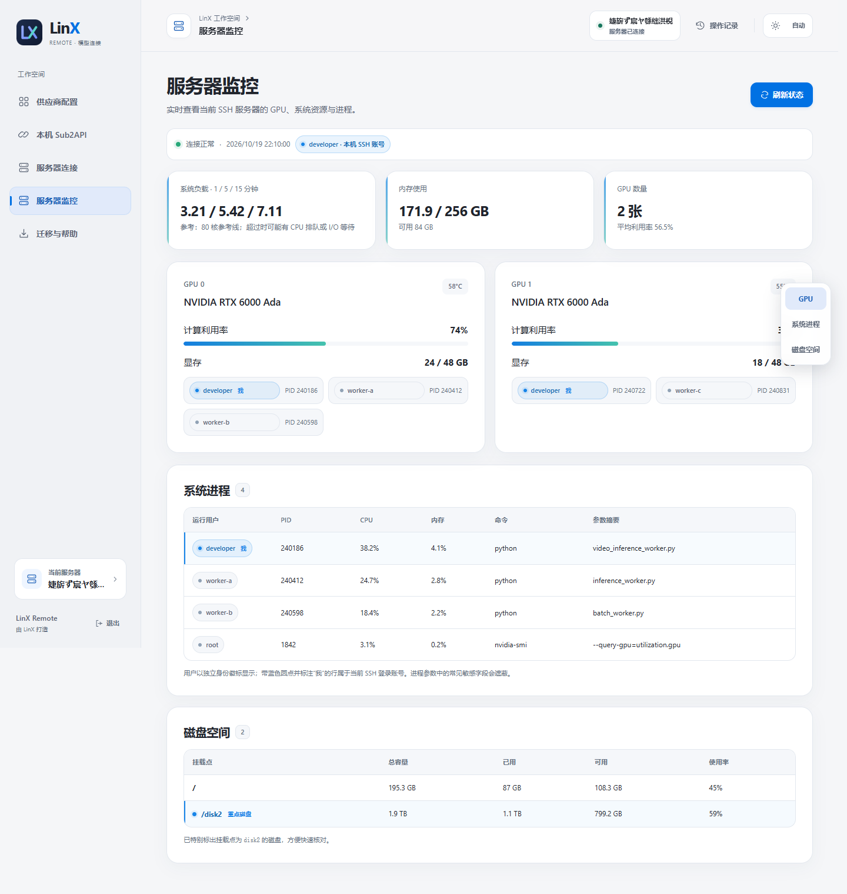
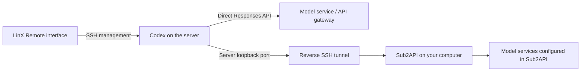

<div align="center">
  <p>
    <a href="README.md"></a>
    <a href="README.en.md"></a>
  </p>
  
  <h1>LinX Remote</h1>
  <p><strong>Connect remote projects to the model services you already use.</strong></p>
  <p>Manage server connections, remote environments, model services, and machine status together.</p>
  <p>
    <a href="https://github.com/LinX-Wang/linx-remote-manager/releases/latest">Download</a> ·
    <a href="#quick-start">Quick start</a> ·
    <a href="docs/USER_GUIDE.md">User guide (中文)</a> ·
    <a href="https://github.com/LinX-Wang/linx-remote-manager/issues/new/choose">Report an issue</a>
  </p>
  <p>
    
    
    <a href="LICENSE"></a>
  </p>
</div>

<picture>
  <source media="(prefers-color-scheme: dark)" srcset="docs/assets/overview-dark.png">
  
</picture>

> All screenshots use fictional demo data. The repository and public packages do not contain the author's server addresses, accounts, API keys, SSH private keys, personal settings, or real conversations. Screenshots show the application's current Chinese interface.

## Why LinX Remote?

Remote projects run on a server, so their model configuration, runtime environment, and machine state need to be managed together. LinX Remote brings server connections, status checks, provider selection, model discovery, configuration switching, access to local Sub2API, and remote environment setup into one interface. Once connected, you can inspect GPU, system load, memory, disk, and process usage through the same SSH session before starting more work.

Connect your server directly to an API provider, or use a reverse SSH tunnel to reach Sub2API on your computer without giving the local service a public IP address.

This is **an independent third-party project by LinX**, not an official Cindy or OpenAI product.

## Features

| Feature | What it does |
| --- | --- |
| Provider management | Add and edit providers; new/inactive providers are saved without switching, while edits to the active provider automatically apply and refresh models |
| Model selection | Fetch, search, select multiple models, select all, or add exact model IDs manually |
| Single-model tests | Choose one model to test; testing is optional before activation |
| Native menu synchronization | Sync the active provider's selected models to Cindy's remote model catalog |
| Local service tunnel | Forward a server loopback port to local Sub2API, with background reconnection |
| Cindy connection discovery | Prefer existing Cindy SSH configurations, with manual connections also supported |
| SSH authentication | Manual connections support runtime-only passwords, SSH Agent, and private-key setup guidance |
| Server connection and state | Reuse Cindy's SSH configuration or connect manually; use section navigation to inspect GPU, system processes, disks, memory, and load, with GPU users and PIDs neatly arranged and common credentials redacted from process arguments |
| Automatic discovery | Check Codex installations, server port availability and local Sub2API on connect, with manual overrides |
| Per-user environment | Check gawk and the complete Codex installation; skip tools that already work |
| Visual updates | Check versions and install on demand, with progress inside the relevant tool card |
| Download fallback | When the server cannot reach GitHub, try downloading locally and transferring over SSH |
| Light and dark themes | Switch with the sun/moon button, or follow local time automatically |
| Computer migration | Shared Windows/macOS core, with a personal migration export |

### Interface preview

**Server connection, state, and updates:** reuse Cindy's SSH configuration and prepare tools in the actual login account's home directory. After connecting, inspect GPU, system processes, and disk usage on the same page; update progress stays next to its action button.


**Server monitoring:** use the section rail to move between GPU, system processes, and disk space. It scrolls horizontally on narrow screens, and GPU users and PIDs line up clearly.



**Automatic discovery**: check paths and ports on connect, choose among instances and preserve existing tunnels.


**Choose the models you need:** fetch, search, and select multiple models, then choose a single model when testing.


<details>
<summary>Small-window and mobile-width layout</summary>


This is the desktop management page in a narrow viewport, not a standalone mobile app. The management service listens on the current computer's loopback address by default.

</details>

## Quick start

### 0. Prerequisites

| Item | When needed | Ready when |
| --- | --- | --- |
| Cindy | When using Cindy remote projects | Installed, with the server saved in remote connection settings and SSH login working |
| Local OpenSSH client | Both connection paths | `ssh -V` prints a version in your terminal |
| Reachable Linux server | Both connection paths | Your account can log in and write to its home directory; Python 3.8+ is available, plus curl and tar for automatic Codex downloads |
| Remote gawk / Codex | Remote project execution | Use the manager's environment preparation action to install per-user tools, or reuse working installations |
| Local Sub2API | **Local tunnel path only** | Docker Desktop or another supported runtime is ready, Sub2API is accessible, upstream accounts are configured, and an API key has been created |
| Direct API URL and key | **Direct path only** | The API supports Responses and is reachable from the server; no local Sub2API or Docker is needed |

Starting from a new computer? Read the **[setup and migration guide](docs/SETUP.en.md)** for Windows deployment commands, Cindy connection setup, API key creation, and migration order.

### 1. Download and launch

Visit [Releases](https://github.com/LinX-Wang/linx-remote-manager/releases/latest).

| Client | Recommended method | Requirements |
| --- | --- | --- |
| Windows | Download the Windows ZIP, fully extract it, and open the EXE | OpenSSH client; Python is not required |
| macOS | Download the portable package, fully extract it, and open the `.app` or `.command` launcher | Python 3.10+ recommended; system OpenSSH |
| From source | Clone the repository and run the commands below | Python 3.8+, OpenSSH, and a modern browser |

On Windows, download `LinX-Remote-<version>-windows.zip`, fully extract it, open the `LinX-Remote` folder, and run **`LinX Remote.exe`**. The standalone release asset is named `LinX.Remote.exe` because GitHub normalizes spaces in asset names; the ZIP still contains `LinX Remote.exe`. GitHub's **Code → Download ZIP** downloads source code, not the Windows package with an EXE.

```bash
git clone https://github.com/LinX-Wang/linx-remote-manager.git
cd linx-remote-manager
python launch.pyw
```

On macOS, use `python3` instead of `python` if needed. Runtime code uses only the Python standard library; no `pip install` is needed.

### 2. Choose a server

Configure your server in Cindy's remote connection settings first. Then open **服务器连接 (Server connection) → 从 Cindy 选择服务器 (Choose from Cindy) → 使用并连接 (Use and connect)** in the manager. The same page provides environment checks and updates; **服务器监控 (Server monitoring)** reads GPU, system load, memory, disk, and process snapshots through the active SSH connection, with side navigation between sections. System load shows 1-, 5-, and 15-minute averages of runnable or uninterruptible tasks, not CPU percentages. Compare it with the server's online CPU core count; a fixed core count is not a universal reference.

You can also enter a host, SSH port, and username manually. The advanced authentication field takes a private key **file path**, not a password or the contents of the key. On first login, verify the host fingerprint and make sure your SSH key or agent is available.

The public version starts without a preconfigured server and will not select or connect to the author's environment.

### 3. Prepare tools and add a provider

Check gawk and Codex under **环境与更新 (Environment and updates)**. Then open **供应商配置 (Provider configuration)**, enter the API base URL and key, fetch and select models, save, and explicitly activate the provider.

Saving edits to the active provider automatically applies them and refreshes the selected models. New or inactive providers never activate on save. Active tasks block application and leave the previous configuration unchanged; save again after tasks finish. Re-enabling an unchanged active configuration only verifies it; endpoint or catalogue changes still require a remote service reload.

- **Direct provider:** the server accesses the upstream API directly, bypassing local Sub2API.
- **Local Sub2API:** start your local service first, then establish a tunnel on the **本机 Sub2API (Local Sub2API)** page.
- **API protocol:** the upstream service must support Responses. Services that only support Chat Completions need a separate protocol adapter; this tool does not perform that conversion automatically.

### 4. Moving to another Windows computer

1. Download and extract the Windows release ZIP, install Cindy, and confirm that local OpenSSH is available.
2. Configure SSH login in Cindy on the new computer. Your old private key, agent state, and trusted host records are not copied automatically.
3. Connect the manager to the **same server account and Codex HOME** to read existing providers and selected models. Their API keys do not need to be entered again.
4. Direct providers are then ready to use. For local Sub2API, deploy or restore Sub2API on the new computer, check the local service, and establish a new tunnel.

The manager's download does not include Sub2API, Docker, databases, or personal provider credentials. Moving the manager does not migrate Sub2API accounts, groups, keys, or data. See [migration details](docs/SETUP.en.md#what-to-migrate-between-computers).

## Two connection paths



The tunnel binds to `127.0.0.1` on the server. The default server port is `18765` and the local service port is `8080`; both are configurable. Your computer and local service must stay online while using the tunnel.

## Privacy and data storage

- The public repository starts with blank settings and contains no real server or provider data.
- Local connection settings are saved in `settings.json`. OpenSSH or your agent uses your SSH private key; the key is not copied into those settings.
- Provider credentials are saved under the configured Codex HOME on the server, with relevant files restricted to the current account. This is **not an encrypted vault**: that server account can still read its own credentials.
- The local interface listens only on loopback and its API uses a random session token. Do not expose it directly to the internet.
- **Export migration package** is a personal backup feature that includes connection settings. **Do not upload a personal migration export as a public release.**
- [Report a bug or request a feature](https://github.com/LinX-Wang/linx-remote-manager/issues/new/choose) using the appropriate form. The forms are in Chinese; answers in English are welcome. Remove keys, private keys, host addresses, and sensitive log content. Use [private vulnerability reporting](https://github.com/LinX-Wang/linx-remote-manager/security/advisories/new) for security issues. See [Security (中文)](SECURITY.md).

## Compatibility and limitations

- The Windows client has been tested in actual use. macOS launch and background behavior have undergone code review and simulated checks, but a complete end-to-end regression on a physical Mac is still pending. The `.app` is unsigned and not notarized.
- The remote worker targets Linux and requires Python 3.8+ and write access to the account's home directory. Automatic gawk setup primarily supports Debian/Ubuntu; other systems may require manual GNU Awk setup.
- Environment setup does not run `sudo`, replace system `awk`, or modify other users' configurations.
- The manager reuses Cindy's SSH configuration but establishes a separate SSH connection. First use may require separate host fingerprint confirmation.
- Projects using the same server account and Codex HOME share configuration. Provider switches and upgrades check whether remote tasks are idle.
- Cindy updates may change its Codex version, model catalog, or internal session interfaces. The connection check reuses a complete, runnable Codex already on the server and does not downgrade it solely because its version is newer; future Cindy interface changes may still require an adaptation.
- Non-GPT models also depend on the upstream service's Responses and tool-calling compatibility. A model appearing in the menu does not mean every tool has been validated with it.

## Reasoning effort and context length

When editing a provider, the model selection page shows a context length for every selected model (262144 tokens by default) and lets you change them independently. The remote catalog exposes low, medium, high, and max reasoning efforts and forwards the selected effort to Codex. Whether a relay accepts a value is decided by that service; a rejection is returned as the server error.

## Development and releases

```bash
python -m unittest discover -s tests -v
python tools/audit_public.py
python tools/build_release.py --source-only
```

Building the Windows EXE requires PyInstaller. Generating demo screenshots requires Playwright. Neither is a runtime dependency. See [Contributing (中文)](CONTRIBUTING.md).

GitHub Actions provides cross-platform checks and manual or tag-triggered package builds. The public source is maintained separately from the author's personal installation, and release files are collected using an explicit allowlist.

## Related projects

- [Cindy](https://github.com/makecindy/cindy): the remote project host.
- [OpenAI Codex](https://github.com/openai/codex): the remote coding tool; installation packages come from its official releases.
- [CC Switch](https://github.com/farion1231/cc-switch): one of the design references for provider configuration management.
- [Changelog (中文)](CHANGELOG.md) · [User guide (中文)](docs/USER_GUIDE.md) · [MIT License](LICENSE)

<div align="center"><sub>Made by LinX · Keep your remote workspace connected.</sub></div>
