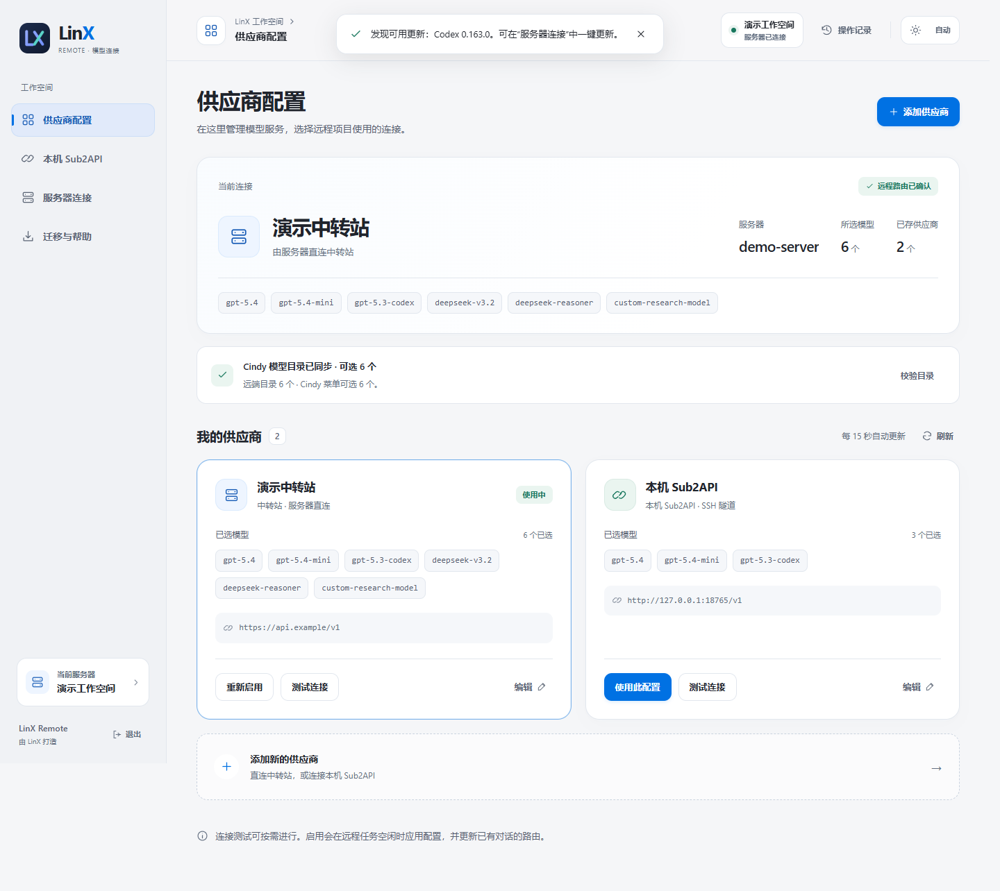
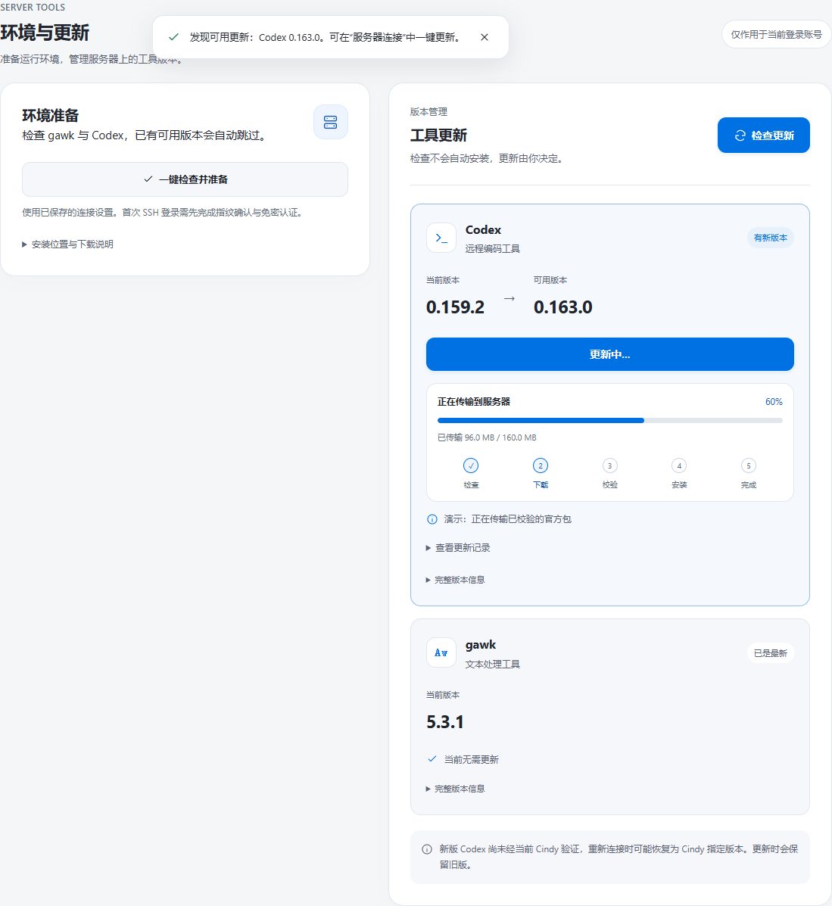
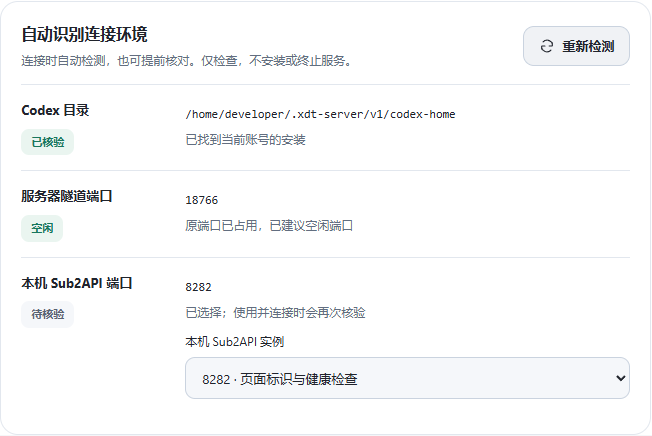
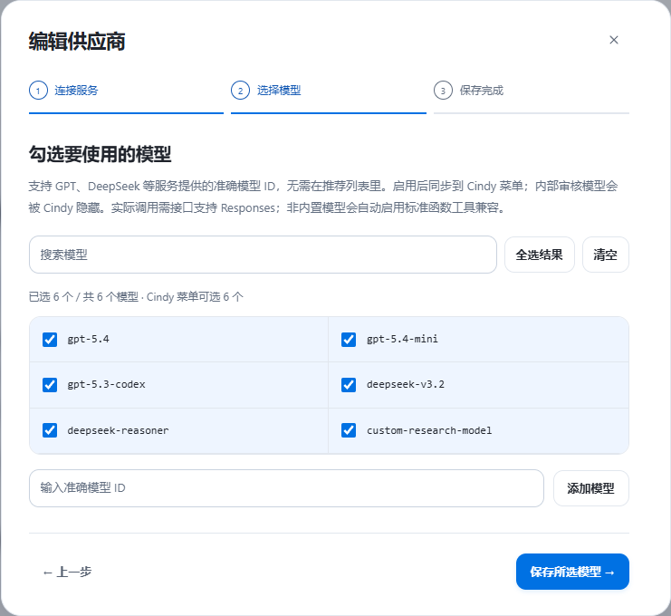
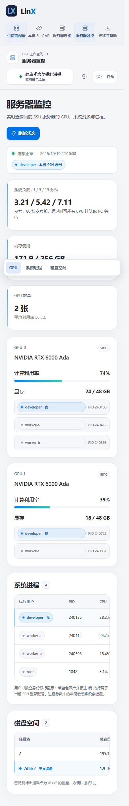
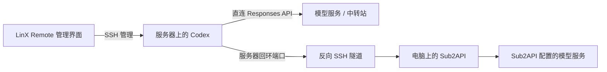

<div align="center">
  <p>
    <a href="README.md"></a>
    <a href="README.en.md"></a>
  </p>
  
  <h1>LinX Remote</h1>
  <p><strong>让远程项目，接上你熟悉的模型服务。</strong></p>
  <p>将服务器连接、远程环境、模型服务与机器状态管理放在一起。</p>
  <p>
    <a href="https://github.com/LinX-Wang/linx-remote-manager/releases/latest">下载最新版</a> ·
    <a href="#快速开始">快速开始</a> ·
    <a href="docs/USER_GUIDE.md">使用指南</a> ·
    <a href="https://github.com/LinX-Wang/linx-remote-manager/issues/new/choose">反馈问题</a>
  </p>
  <p>
    
    
    <a href="LICENSE"></a>
  </p>
</div>

<picture>
  <source media="(prefers-color-scheme: dark)" srcset="docs/assets/overview-dark.png">
  
</picture>

> 截图全部使用虚构演示数据。仓库与公开安装包不含作者的服务器地址、账号、API Key、SSH 私钥、个人配置或真实会话数据。

## 为什么做这个工具

远程项目运行在服务器上，模型配置、运行环境和机器状态也需要一起管理。LinX Remote 把服务器连接、状态查看、选择供应商、获取模型、切换配置、连接本机 Sub2API，以及准备远程运行环境这些操作放进一个界面；连接服务器后，可以在同一处查看 GPU、系统负载、内存、磁盘和进程，判断资源是否足够再继续工作。

你可以让服务器直连 API 服务，也可以通过反向 SSH 隧道使用电脑上已有的 Sub2API，不必给本机服务配置公网地址。

这是 **LinX 的独立第三方项目**，不是 Cindy 或 OpenAI 官方产品。

## 可以做什么

| 功能 | 你可以怎样使用 |
| --- | --- |
| 供应商管理 | 添加、编辑多个供应商；新建或未启用配置只保存，编辑当前供应商自动应用并刷新模型 |
| 模型列表 | 获取模型、搜索、多选、全选与手动补充模型 ID |
| 单模型测试 | 选择一个模型测试连接；启用配置不强制先测试 |
| 原生菜单同步 | 将当前供应商所选模型同步到 Cindy 远程模型目录 |
| 本机服务隧道 | 将服务器回环端口转发至本机 Sub2API，后台重连 |
| 读取 Cindy 连接 | 优先选择 Cindy 使用的 SSH 配置，也支持手动添加 |
| SSH 登录方式 | 手动连接支持账号密码（仅本次运行内存使用）、SSH Agent 与密钥配置指引 |
| 服务器连接与状态 | 复用 Cindy 的 SSH 配置或手动连接；通过分区导航查看 GPU、系统进程、磁盘、内存与负载，GPU 使用者和 PID 清晰排列，进程参数会遮蔽常见凭据 |
| 自动识别环境 | 连接时检测 Codex 安装、服务器端口占用与本机 Sub2API；保留手动调整 |
| 个人目录环境 | 检查 gawk 与完整 Codex，已有可用版本则跳过 |
| 可视化更新 | 检查更新、手动安装；在工具卡片内查看下载与安装进度 |
| 备用下载 | 服务器无法访问 GitHub 时，尝试本机下载后经 SSH 传输 |
| 日夜主题 | 太阳/月亮按钮切换，或按本地时间自动切换 |
| 换电脑使用 | Windows/macOS 共用核心代码，可导出个人迁移包 |

### 界面预览

**服务器连接、状态与更新**：复用 Cindy 的 SSH 配置，按实际登录账号准备个人目录；连接后可查看 GPU、系统进程和磁盘使用情况，更新进度紧邻操作按钮。



**自动检测**：连接时核验目录与端口；多个实例可选择，现有隧道保持不变。



**选择需要的模型**：获取、搜索和多选，测试时再单独选择一个模型。



<details>
<summary>查看小窗口与移动宽度布局</summary>



这里展示的是桌面管理页面在窄视口下的布局，并非独立手机 App。管理服务默认仅监听当前电脑的回环地址。

</details>

## 快速开始

### 0. 先准备哪些东西？

| 准备项 | 是否需要 | 做到什么程度 |
| --- | --- | --- |
| Cindy | 使用 Cindy 远程项目时需要 | 安装后，在「远程连接」中保存服务器并确认能 SSH 登录 |
| 本机 OpenSSH 客户端 | 两种连接方式都需要 | 在 PowerShell 执行 `ssh -V` 能看到版本 |
| 可访问的 Linux 服务器 | 两种连接方式都需要 | 有可登录的账号、个人目录写权限，以及 Python 3.8+；自动下载 Codex 还需 curl、tar |
| 服务器 gawk / Codex | 运行远程项目需要 | 可由管理器「一键检查并准备」安装至个人目录；已有可用版本则跳过 |
| 本机 Sub2API | **仅本机隧道方式需要** | Docker Desktop 等运行环境已就绪，Sub2API 可登录、上游账号已配置，并已创建可用 API Key |
| 直连服务的地址和 Key | **仅直连方式需要** | 服务器可访问、支持 Responses；不需要部署本机 Sub2API 或 Docker |

从零开始、还没有 Cindy 连接或 Sub2API？请先阅读 **[新电脑与前置部署指南](docs/SETUP.zh-CN.md)**，包含 Windows 部署命令、登录验证、API Key 创建和换机顺序。

### 1. 下载并打开

前往 [Releases](https://github.com/LinX-Wang/linx-remote-manager/releases/latest)。

| 客户端 | 推荐方式 | 前置条件 |
| --- | --- | --- |
| Windows | 下载 Windows ZIP，完整解压后双击 EXE | OpenSSH 客户端；无需安装 Python |
| macOS | 下载跨平台包，完整解压后打开其中的 `.app` 或 `.command` | Python 3.10+ 推荐；系统 OpenSSH |
| 源码运行 | 克隆后执行下方命令 | Python 3.8+、OpenSSH、现代浏览器 |

Windows 推荐下载 `LinX-Remote-<版本>-windows.zip`，完整解压后进入 `LinX-Remote` 文件夹，运行 **`LinX Remote.exe`**。发行页的独立 EXE 附件名为 `LinX.Remote.exe`（GitHub 会将文件名中的空格规范为点号）；ZIP 内仍是 `LinX Remote.exe`。GitHub 的「Code → Download ZIP」是源码包，不是带 EXE 的 Windows 发行包。

```bash
git clone https://github.com/LinX-Wang/linx-remote-manager.git
cd linx-remote-manager
python launch.pyw
```

macOS 可将命令中的 `python` 换为 `python3`。运行时只使用 Python 标准库，无需 `pip install`。

### 2. 选择服务器

先在 Cindy 的“远程连接”中配置服务器，再打开管理器的 **服务器连接 → 从 Cindy 选择服务器 → 使用并连接**。连接成功后，管理器会在同一页面提供环境检查与更新入口；“服务器监控”通过当前 SSH 连接只读采集 GPU、系统负载、内存、磁盘和进程快照，并可用侧边分区导航跳转。系统负载显示 1、5、15 分钟平均任务数，不是 CPU 百分比；应结合服务器在线 CPU 核心数理解，不能将某一固定核心数当作所有服务器的标准。

也可以手动填写服务器地址、SSH 端口和用户名。高级认证中填写的是密钥文件路径，不是密码，也不是私钥内容。首次登录需确认主机指纹，并确保 SSH Key / Agent 可用。

公开版首次启动不预置服务器，不会替你选中或连接作者的环境。

### 3. 准备环境并添加供应商

在“环境与更新”中检查 gawk 与 Codex，然后回到“供应商配置”添加 API 根地址和 Key，获取并勾选模型，保存后主动启用。

编辑当前正在使用的供应商后，保存会自动应用并刷新所选模型。新建或编辑未启用的供应商不会自动切换。服务器有任务运行时会阻止应用，原配置保持不变；任务结束后再次保存即可。重复启用未变配置只做校验；实际更换接口或模型目录仍需等待远程服务重新加载。

- **直连供应商**：由服务器访问上游 API，不经过本机 Sub2API。
- **本机 Sub2API**：先启动本机服务，再在“本机 Sub2API”页面建立隧道。
- **API 协议**：上游需支持 Responses。仅支持 Chat Completions 的服务需要额外协议转换；本工具不自动完成该转换。

### 4. 换一台 Windows 电脑

1. 从 Releases 下载 Windows ZIP 并完整解压，安装 Cindy，确认本机 OpenSSH 可用。
2. 在新电脑 Cindy 中配置服务器 SSH 登录；旧电脑的私钥、Agent 和信任记录不会自动复制。
3. 打开管理器，连接**同一服务器账号和 Codex HOME**，即可重新读取服务器上保存的供应商与模型；API Key 不需要重新输入。
4. 如果使用直连供应商，至此可继续使用；如果使用本机 Sub2API，还需在新电脑部署或恢复 Sub2API，确认本机服务可用后重新建立隧道。

管理器下载包不包含 Sub2API、Docker、数据库或你的供应商凭据。迁移管理器不等于迁移 Sub2API 的账号、分组、Key 和数据库；详见 [换机说明](docs/SETUP.zh-CN.md#换电脑时分别迁移什么)。

## 两种连接方式



隧道绑定服务器 `127.0.0.1`；默认服务器端口为 `18765`，本机服务端口为 `8080`，均可修改。使用本机隧道期间，电脑和本机服务需要保持在线。

## 隐私与数据位置

- 公开仓库从空白配置开始，不携带真实服务器或供应商数据。
- 本机 `settings.json` 保存连接设置；SSH 私钥由 OpenSSH / Agent 使用，不复制进配置。
- 供应商凭据保存在服务器指定 Codex HOME 下，相关文件限制为当前账号可读。它们**不是加密保险库**，该服务器账号仍可读取自己的凭据。
- 本地界面只监听回环地址，API 使用随机会话令牌；不要将其直接暴露到公网。
- “导出迁移包”是个人使用功能，会包含连接设置。**个人迁移包不能当成公开发行包上传。**
- [反馈问题或提出建议](https://github.com/LinX-Wang/linx-remote-manager/issues/new/choose)时，请选择对应中文表单，并去掉 Key、私钥、主机地址和日志中的敏感内容。漏洞等安全问题请使用 [私密报告](https://github.com/LinX-Wang/linx-remote-manager/security/advisories/new)，详见 [安全说明](SECURITY.md)。

## 兼容范围与限制

- Windows 客户端已实测。macOS 启动与后台逻辑经过代码和模拟检查，尚未完成 Mac 真机完整回归；`.app` 未签名、未公证。
- 远程工作进程面向 Linux，要求 Python 3.8+ 和个人目录读写权限。gawk 自动准备主要适配 Debian/Ubuntu；其他系统可能需要自行准备 GNU Awk。
- 环境安装不执行 `sudo`，不替换系统 `awk`，不修改其他用户的配置。
- Cindy 的 SSH 配置可复用，但管理器建立的是独立 SSH 连接，首次可能需要单独确认主机指纹。
- 同一服务器账号、同一 Codex HOME 的配置由相关项目共享。供应商切换与升级会检查任务是否空闲。
- Cindy 更新可能调整 Codex 版本、模型目录或内部会话接口。较新 Codex 可能被 Cindy 重新安装为其指定版本，不能保证任意版本永久兼容。
- 非 GPT 模型能否完整工作还取决于上游 Responses 与工具调用兼容性；模型 ID 出现在列表中并不代表全部工具均已验证。

## 开发与发布

```bash
python -m unittest discover -s tests -v
python tools/audit_public.py
python tools/build_release.py --source-only
```

构建 Windows EXE 需额外安装 PyInstaller。生成 README 演示截图需 Playwright；它们都不是运行时依赖。详见 [开发指南](CONTRIBUTING.md)。

GitHub Actions 提供跨平台基础检查和手动/标签触发的发行包构建。公开版与作者个人安装目录分离，所有发布文件都通过白名单收集。

## 项目相关

- [Cindy](https://github.com/makecindy/cindy)：远程项目宿主。
- [OpenAI Codex](https://github.com/openai/codex)：远程编码工具；安装包从官方发布页获取。
- [CC Switch](https://github.com/farion1231/cc-switch)：供应商配置管理设计参考之一。
- [更新记录](CHANGELOG.md) · [使用指南](docs/USER_GUIDE.md) · [MIT License](LICENSE)

<div align="center"><sub>由 LinX 打造 · Keep your remote workspace connected.</sub></div>
